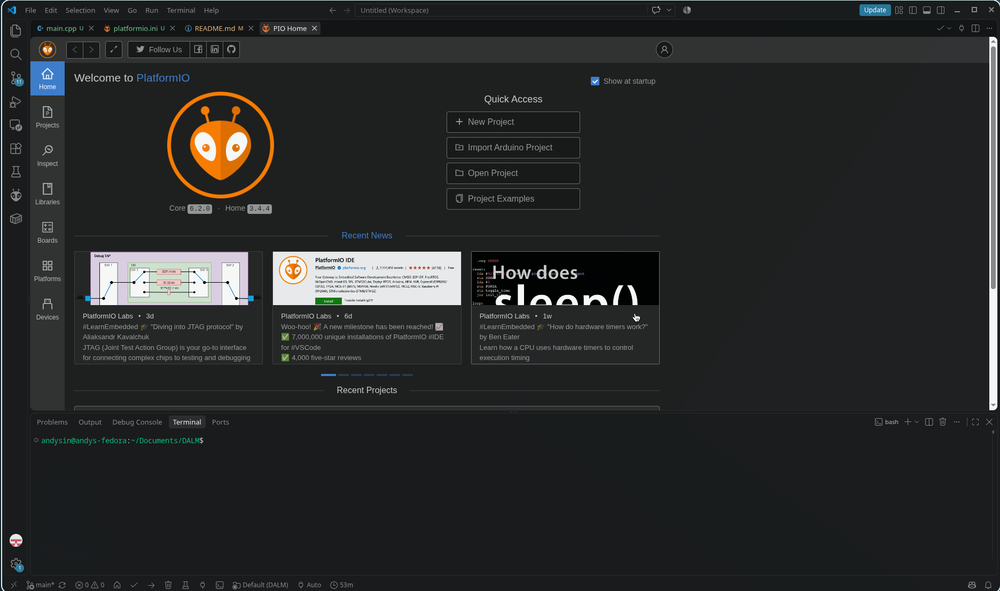

# The DALM

### The Deadlock Ability Light Machine

The DALM is a project that I'm working that combines Deadlock (a game I'm currently obsessed with) and physical hardware. It's meant to be a beginner project in terms of difficulty, and provide real utility to me as I play. At the current moment, all that's planned for it is that it lights up LEDs based on ability cooldowns.

### How It Helps:

This solves a pretty niche problem for me:

1. I'm lowkey blind and I can't see when my abilities go off cooldown
2. All the stuff happening on screen makes it so that my brain is fried by all the OTHER sensory inputs (i.e concentrating on aiming, sensation of mousepad, sensation of arm on keyboard, sensation of fingers touching mousepad, the tons of things I have to dodge, listening for sounds/sound cues, keeping track of my health and stamina AND bullets [so I don't reload at a bad time])

[INSERT DEADLOCK GAME IMAGE HERE]

So yeah, pretty nifty project. I love Deadlock. And hardware. And coding. And Vyper (Vyper mentioned?).

### The Beginning Process:

- So, I started off with just the basic GitHub empty repo (with a README) and git cloning that into a folder onto my laptop.
- I then installed the PlatformIO extension and watched a video on how to set up a project (I didn't need the video). For this project, I will be using an Arduino Uno, but I prefer an ESP32 (Sigh... money):

  

- Then, I realized a couple of issues:
  - Wait a minute, how am I supposed to do a mod like this?
  - A VAST, VAST majority of mods on Deadlock are cosmetic mods that replace the models in-game, so they don't mess with UI at all.
  - Even the ones that do modify UI do it cosmetically.

**Then, I stumbled upon _it._**

- One of the most cursed mods to ever bless the Deadlock fandom: Lovelock. What this accursed mod does is connect your Deadlock gampeplay to.. uhm... **_toys..._** and makes things happen whenever a major event happens in game.
- Despite the unconventional mod, it was perfect for me because it listened to events in game and gave "physical" feedback.

**Problem Solved! Right..?**

- OBVIOUSLY not. Now, I have to actually build the mod, taking inspiration from Lovelock along the way.
- (Note: As I write this, I realize there is another Deadlock hardware mod called DeadlockShock. I uh, I'm using that as my reference. Sorry not sorry, Lovelock... not really.)

### Mod Development:

- I began looking at the reference mod (DeadlockShock) and how it detected ability states in game and how it searched for them.
- It turns out that Deadlock uses something called "Panorama", which is Valve's UI framework, and it functions similarly to web development.
- It was surprising that Panorama used Javascript, and so it gave me somewhere to start.
- I used what I learned from my Data Structures class and began all my functions (and my development) with a design recipe, and the first thing I wanted to do was to be able to change states and check for ability readiness and whatnot, thus the functions I developed in abilityTracker.js.
- Now that I coded up my abilityTracker.js, the last thing to do was to test it.
- To do this, I had to install Reduced CSDK 12, which is the toolchain to build my mod.
